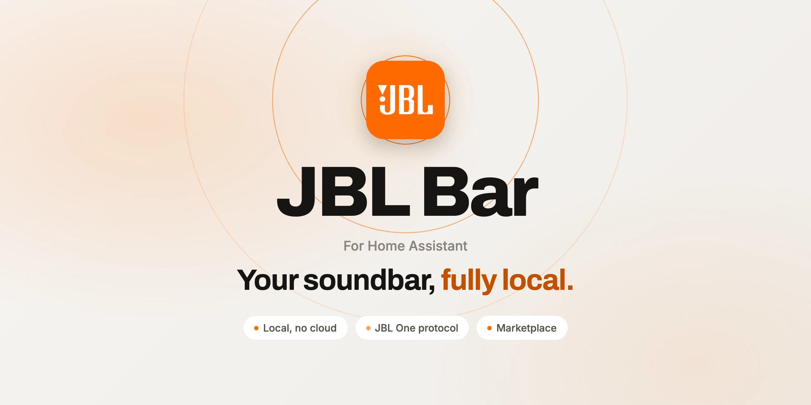

<div align="center">

<picture>
  <source media="(prefers-color-scheme: dark)" srcset="docs/images/readme-title-dark.webp" />
  
</picture>

[](https://github.com/SH1FT-W/jbl-bar/releases/latest)
[](https://www.home-assistant.io)
[](https://hacs.xyz)

<a href="https://sh1ft-w.github.io/jbl-bar"><b>Website</b></a>&emsp;<a href="#get-started">Get started</a>&emsp;<a href="#entities">Entities</a>&emsp;<a href="#examples">Examples</a>&emsp;<a href="CHANGELOG.md">Changelog</a>

</div>

<br/>

Your JBL soundbar in Home Assistant, the way the JBL One app sees it: **power, volume, source, EQ, sound switches, rear speakers and the live Dolby Atmos format.** Straight over your network, without cloud.

Made for the **JBL Bar series with JBL One** (Bar 300, 500, 700, 800, 1000, 1300 and the MK2 models). Every command was read from the app and tried out on a **Bar 1000** (firmware 25.52). Users also run it on a **Bar 1000 MK2** (OneOS 4.0), a **Bar 800** and a **Bar 500**. It replaces `jbl_integration` and **keeps its entity IDs**.

## What you get

|  | See | Change |
|:--|:--:|:--:|
| Power, read from the bar instead of guessed | ✓ | ✓ |
| Volume, mute, source (TV, HDMI, Bluetooth) | ✓ | ✓ |
| Play, pause, skip, title, artist and cover while streaming | ✓ | ✓ |
| EQ preset and all 7 bands | ✓ | ✓ |
| Night mode, Smart mode, PureVoice, feedback tones | ✓ | ✓ |
| Audio sync (up to 250 ms) | ✓ | ✓ |
| Sleep timer (15 minutes to 2 hours) | ✓ | only while on |
| Dolby Atmos and audio format, pushed instantly | ✓ | |
| Atmos level | ✓ | cycle by button |
| Rear speakers: battery, charging, docked, connected | ✓ | |
| Rear speaker volume (muted, low, medium, high) | ✓ | only while detached |
| Broadcast of detached rear speakers and deep sleep, where the bar has them | ✓ | ✓ |
| Power-on and playback time | ✓ | |
| Announcements and text to speech | | ✓ |

Features a model does not know are not created.

**New in 26.11:** announcements with `tts.speak`, after which the bar gets its source, volume and standby back; the input as a select for automations; rear speaker volume, broadcast and deep sleep; power-on and playback time; audio format events survive a new IP address; and commands no longer fail now and then with "Server disconnected". Every change is in the [changelog](CHANGELOG.md).

<a id="get-started"></a><a id="install"></a><a id="set-up"></a>
## Get started

[](https://my.home-assistant.io/redirect/hacs_repository/?owner=SH1FT-W&repository=jbl-bar&category=integration)

For the audio format and for announcements the bar has to reach Home Assistant: the internal URL in Home Assistant's network settings should be an IP address (the default on most installations).

1. **Install it.** Search for **JBL Bar** under **Settings > Marketplace** (called HACS before Home Assistant 2026.11), download it and restart Home Assistant.
2. **Add the bar.** It usually shows up under **Settings > Devices & services > Discovered**. If not, choose **Add integration > JBL Bar** and enter its IP address.
3. **Pick an announcement volume** if you like, under **three dots > Configure**. 0 (the default) keeps the current volume.

If the bar gets a new IP address later, use **three dots > Reconfigure**.

<details>
<summary>Install by hand</summary>

1. Download the [latest release](https://github.com/SH1FT-W/jbl-bar/releases/latest).
2. Copy `custom_components/jbl_bar` into `/config/custom_components/` and restart Home Assistant.

</details>

<a id="coming-from-jbl_integration"></a>
<details>
<summary>Coming from <code>jbl_integration</code></summary>

1. **Delete the old integration** and remove it in the Marketplace. This frees its entity IDs.
2. **Install JBL Bar** and restart Home Assistant.
3. **Add the bar.** All previous IDs are back, so automations, dashboards and energy sensors keep working. New are the media player, audio sync, sleep timer, feedback tones, source and the Atmos sensors.

Only the raw values that were disabled by default (`transport_state`, …) and the source and volume buttons are gone. The media player does that now. `play_medium` is back since 26.11.5.

</details>

<a id="entities"></a>
## Entities

IDs for a bar named "JBL Bar 1000", the same as in `jbl_integration`. Names are in English and German.

| Entity | Shows |
|:--|:--|
| `media_player.jbl_bar_1000` | The main control: power, volume, mute, source, playback and now playing. Plays URLs and announcements. |
| `switch.jbl_bar_1000_power` | On or standby |
| `switch.jbl_bar_1000_nightmode`, `_smart_mode`, `_pure_voice`, `_feedback_tone` | Sound switches |
| `number.jbl_bar_1000_volume` | 0 to 100 % in 3 % steps, like on the bar |
| `number.jbl_bar_1000_125hz` … `_8000hz` | EQ bands from −6 to +6 dB (125 Hz down to −9 dB). Changing one creates your own preset. |
| `number.jbl_bar_1000_audio_sync` | 0 to 250 ms |
| `select.jbl_bar_1000_source` | Input: TV, HDMI or Bluetooth, the same as the media player's source |
| `select.jbl_bar_1000_eq_preset` | JBL SIGNATURE, VOCAL, ENERGETIC, CHILL or your own |
| `select.jbl_bar_1000_sleep_timer` | Sleep timer, the remaining time as an attribute |
| `select.jbl_bar_1000_broadcast` | Broadcast of detached rear speakers: off, mono or stereo. Only on bars that report the feature. |
| `select.jbl_bar_1000_rear_volume` | Volume of the detached rear speakers: muted, low, medium or high. Unavailable while they are docked. |
| `switch.jbl_bar_1000_deep_sleep` | Deep sleep. Only on bars that report the feature. |
| `sensor.jbl_bar_1000_power_on_time`, `_playback_time` | The bar's lifetime counters. Only on bars that report them. |
| `sensor.jbl_bar_1000_source`, `_audio_format`, `_atmos_level` | Selected input, incoming format (for example ATMOS / DDP / 6ch / 48 kHz), Atmos level |
| `sensor.jbl_bar_1000_play_medium` | What is playing, as the bar reports it: `TV`, `HDMI`, `BLUETOOTH`, or a stream such as `AIRPLAY` or `CAST`. Unknown in standby. Disabled by default, as in `jbl_integration`. |
| `binary_sensor.jbl_bar_1000_atmos_active` | Dolby Atmos is coming in |
| `button.jbl_bar_1000_atmos`, `_bass`, `_moment`, `_calibration`, `_rear`, `_hdmi` | The remote's buttons; `_hdmi` steps through the HDMI inputs |
| `button.jbl_bar_1000_hdmi_1`, `_hdmi_2`, `_hdmi_3` | Switch straight to one HDMI input. Disabled by default. |

<details>
<summary>Rear speakers (each its own device under the bar)</summary>

| Entity | Shows |
|:--|:--|
| `sensor.jbl_bar_1000_left_battery`, `_right_battery` | Battery |
| `binary_sensor.jbl_bar_1000_left_charging`, `_right_charging` | Charging |
| `binary_sensor.jbl_bar_1000_left_docked`, `_right_docked` | Docked to the bar |
| `binary_sensor.jbl_bar_1000_left_online`, `_right_online` | Connected |

</details>

<a id="examples"></a>
## Examples

Let the bar speak:

```yaml
action: tts.speak
target:
  entity_id: tts.home_assistant_cloud
data:
  media_player_entity_id: media_player.jbl_bar_1000
  message: The washing machine is done.
```

Announcements (`tts.speak`, or `media_player.play_media` with `announce: true`) wake the bar and unmute it if needed. Afterwards it gets back its source, volume, mute and standby. A second announcement waits for the first. Without `announce`, the bar keeps playing the stream.

Switch the input, for example to Bluetooth (`tv`, `hdmi` or `bluetooth`):

```yaml
action: select.select_option
target:
  entity_id: select.jbl_bar_1000_source
data:
  option: bluetooth
```

`media_player.select_source` with `source: Bluetooth` on the media player does the same.

## Good to know

- **Rear volume** only works with the rears detached, so its select is unavailable while they are docked. The bar remembers the last level.
- **Source HDMI** wakes the bar even when nothing is connected to the HDMI input.
- **Changes from the remote** show up within 10 seconds. Only the audio format arrives instantly.
- **Announcements** interrupt everything, including the TV sound. Changes made during one are overwritten by the restore, and a restart or reload during one restores nothing.

<details>
<summary>Troubleshooting</summary>

- **All entities "unavailable".** The bar does not answer at its IP address. Check in your router whether it got a new one and enter it with **three dots > Reconfigure**. A single dropout (for example while going to standby) is bridged.
- **Audio format stays empty, or announcements are silent.** The bar cannot reach Home Assistant. Check the internal URL (an IP address, not a host name) and whether a firewall blocks port 8123 from the bar's network.
- **Source does not come back right away after an announcement.** It comes back once the bar reports the end (at the latest after 10 minutes, or after 15 seconds if it never started).
- **Rear speakers missing.** They appear as soon as the bar reports them. Rears the bar no longer knows can be deleted on their device page.
- **Debug log:**

  ```yaml
  logger:
    logs:
      custom_components.jbl_bar: debug
  ```

When you open an [issue](https://github.com/SH1FT-W/jbl-bar/issues), attach the diagnostics (**Settings > Devices & services > JBL Bar > three dots > Download diagnostics**). IP address, MAC address and serial number are left out.

</details>

<details>
<summary>Remove</summary>

1. **Settings > Devices & services > JBL Bar > three dots > Delete** (for each bar). The event subscription ends on the way out.
2. Remove the repository in the Marketplace (or delete `/config/custom_components/jbl_bar`) and restart Home Assistant.

</details>

<details>
<summary>How it works</summary>

| Channel | Used for | How often |
|:--|:--|:--|
| HTTPS with the app's client certificate | Power, settings, EQ, source | state every 10 seconds, settings every minute and after each change; in standby only power |
| UPnP / SOAP | Title, cover, volume, mute, playing URLs | every 10 seconds while on |
| UPnP events | Audio format and Dolby Atmos, pushed by the bar | the moment it changes |

The bar only talks to clients that present the JBL One app's client certificate. The certificate in `custom_components/jbl_bar/certs/` comes from [MrBearPresident/JBL_Soundbar](https://github.com/MrBearPresident/JBL_Soundbar) (MIT License, Copyright (c) 2025 Jerre Latruwe); thanks for the groundwork. Protocol notes, including the firmware's pitfalls, are in [`CLAUDE.md`](CLAUDE.md) (German).

</details>

<details>
<summary>Development</summary>

```bash
python -m pytest -q -p no:logging        # fake bar in tests/common.py, no real bar needed
uvx ruff check . && uvx ruff format --check .
uvx mypy@2.3.1 --python-executable <venv>/bin/python
python tools/pruefe-uebersetzungen.py    # strings.json against translations/*.json
```

Test requirements: `pip install -r requirements_test.txt`. GitHub Actions runs the same checks plus HACS validation and hassfest. Quality scale: platinum, [self-assessed](custom_components/jbl_bar/quality_scale.yaml).

</details>

<details>
<summary>Thanks</summary>

JBL Bar stands on the work of others and gets better with every bug report and every idea. A big thank you to:

- [**@MrBearPresident**](https://github.com/MrBearPresident): the biggest thanks of all. He built [`jbl_integration`](https://github.com/MrBearPresident/JBL_Soundbar), the integration JBL Bar grew out of and replaces, found the way to talk to the bar and maintained it for more than two years. The client certificate comes from his project. He pointed his users here himself and still reported the missing discovery and the battery reading on his Bar 800.
- [**@hadrbrt**](https://github.com/hadrbrt): the wish for broadcast, and beta after beta tested on a Bar 1000 MK2. Rear volume, broadcast and the usage times are confirmed there because of him.
- [**@tgechev**](https://github.com/tgechev): the first pull request, which brought the `play_medium` sensor back.
- [**@xitters**](https://github.com/xitters), [**@matanmesika**](https://github.com/matanmesika): the EQ bands in the right order and the push for the input as its own select.

Found something or missing a feature? [Open an issue](https://github.com/SH1FT-W/jbl-bar/issues/new/choose).

</details>

## License

[Apache License 2.0](LICENSE), Copyright 2026 SH1FT-W. The client certificate is third-party material under the MIT License, see [`certs/LICENSE`](custom_components/jbl_bar/certs/LICENSE) and [`NOTICE`](NOTICE).

<sub>JBL Bar is an independent project, not affiliated with, endorsed or sponsored by Harman International, JBL or Linkplay. JBL is a trademark of Harman International Industries, Incorporated.</sub>

<br/>

<div align="center">
<a href="https://sh1ft-w.github.io"></a>
<br/>
<sub>More open source for Home Assistant and the Mac at <a href="https://sh1ft-w.github.io">sh1ft-w.github.io</a></sub>
<br/>
<sub>Like this project? <a href="https://buymeacoffee.com/sh1ft_w">Buy me a coffee</a></sub>
</div>
