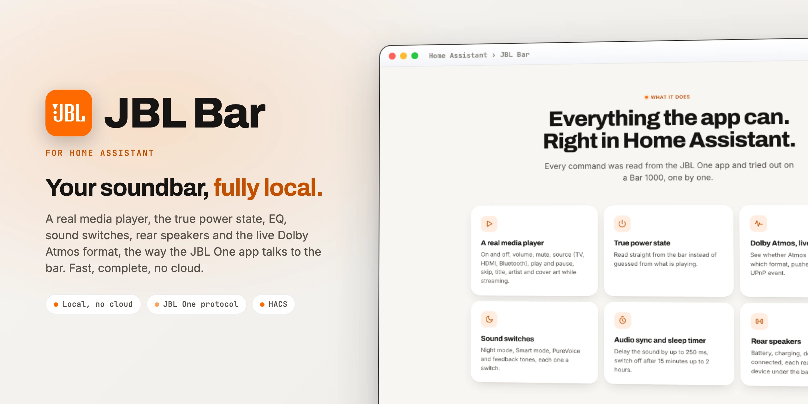

<div align="center">

<picture>
  <source media="(prefers-color-scheme: dark)" srcset="docs/images/readme-title-dark.webp" />
  
</picture>

<p>Local control for JBL soundbars with JBL One in Home Assistant.<br/>
Fast, complete, no cloud.</p>

[](https://github.com/SH1FT-W/jbl-bar/releases/latest)
[](https://www.home-assistant.io)
[](https://hacs.xyz)
[](https://developers.home-assistant.io/docs/creating_integration_manifest/#iot-class)
[-FF6A00?style=flat-square&labelColor=111111)](custom_components/jbl_bar/quality_scale.yaml)
[](LICENSE)

<p><a href="https://sh1ft-w.github.io/jbl-bar"><b>Website</b></a> &nbsp;·&nbsp; <a href="#new">New</a> &nbsp;·&nbsp; <a href="#features">Features</a> &nbsp;·&nbsp; <a href="#entities">Entities</a> &nbsp;·&nbsp; <a href="#installation">Install</a> &nbsp;·&nbsp; <a href="#migration-from-jbl_integration">Migration</a> &nbsp;·&nbsp; <a href="#troubleshooting">Troubleshooting</a> &nbsp;·&nbsp; <a href="CHANGELOG.md">Changelog</a></p>

</div>

<br/>

JBL Bar controls soundbars of the **JBL Bar series** (Bar 300, 500, 700, 800, 1000, 1300 and the MK2 models) over the same local interface the JBL One app uses. Every command was read from the app itself and tried out, one by one, on a **Bar 1000** (firmware 25.52, JBL One 3.0).

It replaces the HACS integration `jbl_integration` and **keeps its entity IDs**, so automations, dashboards and energy sensors keep working without a single change.

> [!NOTE]
> JBL Bar is an independent project. It is not affiliated with, endorsed by or sponsored by Harman International, JBL or Linkplay. JBL is a trademark of Harman International Industries, Incorporated.

<br/>

<a id="new"></a>
<sub><b>JUST ARRIVED</b></sub>
## Sturdier, quieter, and counted by the calendar.

<!-- cards:new -->
<table>
<tr><td width="50%" valign="top"><picture><source media="(prefers-color-scheme: dark)" srcset="docs/images/icons/power-sleep-dark.svg"></picture> <b>Quiet in standby</b> <code>26.10.2</code><br>While the bar sleeps, Home Assistant only asks whether it is on. Switch it on and playback and settings are read right away.</td><td width="50%" valign="top"><picture><source media="(prefers-color-scheme: dark)" srcset="docs/images/icons/playlist-check-dark.svg"></picture> <b>Odd lists, no error</b> <code>26.10.2</code><br>Unknown entries in the bar's EQ preset or rear speaker lists are skipped, the valid ones stay. A missing EQ band gives a clear message instead of a crash.</td></tr>
<tr><td width="50%" valign="top"><picture><source media="(prefers-color-scheme: dark)" srcset="docs/images/icons/dns-outline-dark.svg"></picture> <b>Host names work</b> <code>26.10.2</code><br>Set up with a host name instead of an IP address? The audio format events now get through too, the sender check resolves the name on startup.</td><td width="50%" valign="top"><picture><source media="(prefers-color-scheme: dark)" srcset="docs/images/icons/calendar-outline-dark.svg"></picture> <b>Calendar versions</b> <code>26.10.1</code><br>Year, month and the release of that month: 26.10.2 is the second release of October 2026. The jump from 1.0.1 is intended, updates show up as usual.</td></tr>
</table>
<!-- /cards:new -->

Every change, release by release, in the [changelog](CHANGELOG.md).

<a id="features"></a>
## Features

<!-- cards:features -->
<table>
<tr><td width="50%" valign="top"><picture><source media="(prefers-color-scheme: dark)" srcset="docs/images/icons/play-circle-outline-dark.svg"></picture> <b>A real media player</b><br>On and off, volume, mute, source (TV, HDMI, Bluetooth), play and pause, next and previous, title, artist and cover art while streaming.</td><td width="50%" valign="top"><picture><source media="(prefers-color-scheme: dark)" srcset="docs/images/icons/power-dark.svg"></picture> <b>True power state</b><br>Read straight from the bar instead of guessed from what is playing.</td></tr>
<tr><td width="50%" valign="top"><picture><source media="(prefers-color-scheme: dark)" srcset="docs/images/icons/tune-vertical-dark.svg"></picture> <b>7-band EQ and presets</b><br>JBL SIGNATURE, VOCAL, ENERGETIC, CHILL and your own preset, every band from 125 Hz to 8 kHz adjustable on its own.</td><td width="50%" valign="top"><picture><source media="(prefers-color-scheme: dark)" srcset="docs/images/icons/weather-night-dark.svg"></picture> <b>Sound switches</b><br>Night mode, Smart mode, PureVoice and feedback tones, each one a switch.</td></tr>
<tr><td width="50%" valign="top"><picture><source media="(prefers-color-scheme: dark)" srcset="docs/images/icons/timer-outline-dark.svg"></picture> <b>Audio sync and sleep timer</b><br>Delay the sound by up to 250 ms, switch off after 15 minutes up to 2 hours.</td><td width="50%" valign="top"><picture><source media="(prefers-color-scheme: dark)" srcset="docs/images/icons/speaker-multiple-dark.svg"></picture> <b>Rear speakers</b><br>Battery, charging, docked and connected, each rear as its own device under the bar.</td></tr>
<tr><td width="50%" valign="top"><picture><source media="(prefers-color-scheme: dark)" srcset="docs/images/icons/dolby-dark.svg"></picture> <b>Dolby Atmos and audio format</b><br>See whether Atmos is coming in and in which format, for example ATMOS / DDP / 6ch / 48 kHz, pushed instantly by a UPnP event.</td><td width="50%" valign="top"><picture><source media="(prefers-color-scheme: dark)" srcset="docs/images/icons/rocket-launch-outline-dark.svg"></picture> <b>Adapts and starts instantly</b><br>Features a model does not know are never created. The event subscription runs in the background, Home Assistant does not wait for it.</td></tr>
</table>
<!-- /cards:features -->

<a id="entities"></a>
## Entities

<!-- cards:entities -->
<table>
<tr><td width="50%" valign="top"><picture><source media="(prefers-color-scheme: dark)" srcset="docs/images/icons/speaker-dark.svg"></picture> <b>Media player</b><br>media_player.jbl_bar_1000 is the main control: power, volume, mute, source, playback and now playing.</td><td width="50%" valign="top"><picture><source media="(prefers-color-scheme: dark)" srcset="docs/images/icons/toggle-switch-outline-dark.svg"></picture> <b>Switches</b><br>power, nightmode, smart_mode, pure_voice and feedback_tone.</td></tr>
<tr><td width="50%" valign="top"><picture><source media="(prefers-color-scheme: dark)" srcset="docs/images/icons/volume-high-dark.svg"></picture> <b>Volume and EQ bands</b><br>volume from 0 to 100 % in 3 % steps like on the bar. 125hz to 8000hz from -6 to +6 dB (125 Hz down to -9 dB), changing a band creates your own preset.</td><td width="50%" valign="top"><picture><source media="(prefers-color-scheme: dark)" srcset="docs/images/icons/form-dropdown-dark.svg"></picture> <b>Audio sync and selects</b><br>audio_sync from 0 to 250 ms. eq_preset and sleep_timer as selects, the remaining time as an attribute.</td></tr>
<tr><td width="50%" valign="top"><picture><source media="(prefers-color-scheme: dark)" srcset="docs/images/icons/information-outline-dark.svg"></picture> <b>Sensors</b><br>source, audio_format and atmos_level, plus left_battery and right_battery per rear speaker.</td><td width="50%" valign="top"><picture><source media="(prefers-color-scheme: dark)" srcset="docs/images/icons/remote-dark.svg"></picture> <b>Binary sensors and buttons</b><br>atmos_active, left/right charging, docked and online. Buttons for the remote: atmos, bass, moment, calibration and rear.</td></tr>
</table>
<!-- /cards:entities -->

All IDs start with the device name, for example `switch.jbl_bar_1000_nightmode`, and are the same as in `jbl_integration`. Entity names are available in English and German.

<details>
<summary>All entity IDs (for a bar named "JBL Bar 1000")</summary>

```
media_player.jbl_bar_1000
switch.jbl_bar_1000_power            switch.jbl_bar_1000_nightmode
switch.jbl_bar_1000_smart_mode       switch.jbl_bar_1000_pure_voice
switch.jbl_bar_1000_feedback_tone
number.jbl_bar_1000_volume           number.jbl_bar_1000_audio_sync
number.jbl_bar_1000_125hz … number.jbl_bar_1000_8000hz
select.jbl_bar_1000_eq_preset        select.jbl_bar_1000_sleep_timer
sensor.jbl_bar_1000_source           sensor.jbl_bar_1000_audio_format
sensor.jbl_bar_1000_atmos_level
sensor.jbl_bar_1000_left_battery     sensor.jbl_bar_1000_right_battery
binary_sensor.jbl_bar_1000_atmos_active
binary_sensor.jbl_bar_1000_left_charging   binary_sensor.jbl_bar_1000_right_charging
binary_sensor.jbl_bar_1000_left_docked     binary_sensor.jbl_bar_1000_right_docked
binary_sensor.jbl_bar_1000_left_online     binary_sensor.jbl_bar_1000_right_online
button.jbl_bar_1000_atmos            button.jbl_bar_1000_bass
button.jbl_bar_1000_moment           button.jbl_bar_1000_calibration
button.jbl_bar_1000_rear
```

</details>

## Installation

### HACS (custom repository)

1. In HACS, open the three dots menu, choose **Custom repositories** and add `https://github.com/SH1FT-W/jbl-bar` with the type **Integration**.
2. Search for **JBL Bar**, download it and restart Home Assistant.

### Manual

1. Download the [latest release](https://github.com/SH1FT-W/jbl-bar/releases/latest).
2. Copy the folder `custom_components/jbl_bar` into `/config/custom_components/` and restart Home Assistant.

Requires Home Assistant 2026.9 or newer.

## Setup

1. The bar is discovered automatically (**Settings > Devices & services > Discovered**). Otherwise choose **Add integration > JBL Bar** and enter its IP address.
2. If the bar gets a new IP address later, use **three dots > Reconfigure**.

> [!TIP]
> For the audio format the bar has to reach Home Assistant: in Home Assistant's network settings the internal URL should be an IP address (the default on most installations).

## Migration from `jbl_integration`

1. Delete the old integration and remove it in HACS. This frees its entity IDs.
2. Install JBL Bar and restart Home Assistant.
3. Add the bar. All previous IDs are back; new are the media player, audio sync, sleep timer, feedback tones, source and the Atmos sensors.

Only the raw values that were disabled by default (`play_medium`, `transport_state`, …) and the source and volume buttons are gone. The media player does that now.

## Good to know

- **Sleep timer** is only accepted while the bar is on. In standby the bar ignores it.
- **Rear volume** does not change while the rear speakers are docked to the bar, so there is no entity for it (yet).
- **Atmos level** can only be cycled with the button. The firmware has no way to set it directly.
- **Source HDMI** wakes the bar even when nothing is connected to the HDMI input.
- **Tested on the Bar 1000 only.** The other models of the series speak the same interface; features a model does not know are not created.
- **Polling every 10 seconds.** Changes made on the bar itself (remote control) therefore show up with up to 10 seconds delay; only the audio format arrives instantly as an event.

## Troubleshooting

- **All entities "unavailable".** The bar does not answer at its IP address. Check in your router whether it got a new one and enter it with **three dots > Reconfigure**. A single dropout (for example while going to standby) is bridged.
- **Audio format stays empty.** The bar cannot reach Home Assistant. Check the internal URL in the network settings (an IP address, not a host name) and whether a firewall blocks port 8123 from the bar's network.
- **Rear speakers missing.** They appear as soon as the bar reports them, also later on. Rears the bar no longer knows can be deleted on their device page.
- **Diagnostics:** **Settings > Devices & services > JBL Bar > three dots > Download diagnostics**. IP address, MAC address and serial number are left out.
- **Debug log:**

  ```yaml
  logger:
    logs:
      custom_components.jbl_bar: debug
  ```

When you open an [issue](https://github.com/SH1FT-W/jbl-bar/issues), please attach the diagnostics file.

## Removal

1. **Settings > Devices & services > JBL Bar > three dots > Delete** (for each bar). The event subscription unsubscribes from the bar on the way out.
2. Delete the folder `/config/custom_components/jbl_bar` (or remove the repository in HACS) and restart Home Assistant.

## How it works

<!-- cards:how -->
<table>
<tr><td width="33%" valign="top"><picture><source media="(prefers-color-scheme: dark)" srcset="docs/images/icons/lock-outline-dark.svg"></picture> <b>HTTPS + certificate</b><br>State, settings, EQ and source through the bar's local API, every 10 seconds.</td><td width="33%" valign="top"><picture><source media="(prefers-color-scheme: dark)" srcset="docs/images/icons/music-note-outline-dark.svg"></picture> <b>UPnP / SOAP</b><br>Title, cover, volume and mute through the bar's media renderer.</td><td width="33%" valign="top"><picture><source media="(prefers-color-scheme: dark)" srcset="docs/images/icons/lightning-bolt-outline-dark.svg"></picture> <b>UPnP events</b><br>The bar pushes the audio format to Home Assistant the moment it changes.</td></tr>
</table>
<!-- /cards:how -->

The integration polls the state every 10 seconds, the settings once a minute and right after every change. In standby it only asks for the power state.

The bar's local API only talks to clients that present the JBL One app's client certificate. The certificate in `custom_components/jbl_bar/certs/` comes from [MrBearPresident/JBL_Soundbar](https://github.com/MrBearPresident/JBL_Soundbar) (MIT License, Copyright (c) 2025 Jerre Latruwe); thanks for the groundwork. Protocol notes, including the firmware's pitfalls, are in [`CLAUDE.md`](CLAUDE.md) (German).

## Development

```bash
python -m pytest -q -p no:logging        # fake bar in tests/common.py, no real bar needed
uvx ruff check . && uvx ruff format --check .
uvx mypy@2.3.1 --python-executable <venv>/bin/python
python tools/pruefe-uebersetzungen.py    # strings.json against translations/*.json
```

Install the test requirements with `pip install -r requirements_test.txt`. The same checks run on GitHub Actions for every push and pull request, plus HACS validation and hassfest.

## License

[Apache License 2.0](LICENSE), Copyright 2026 SH1FT-W.

The client certificate in `custom_components/jbl_bar/certs/` is third-party material under the MIT License, see [`certs/LICENSE`](custom_components/jbl_bar/certs/LICENSE) and [`NOTICE`](NOTICE).
